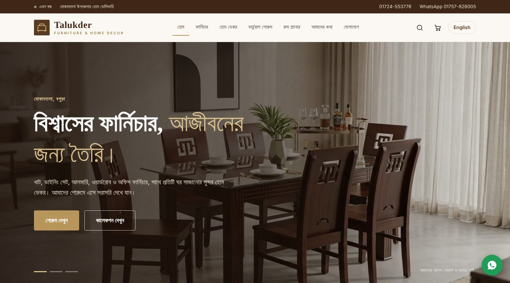
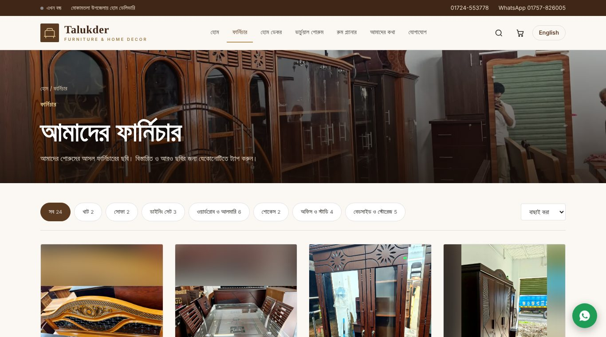
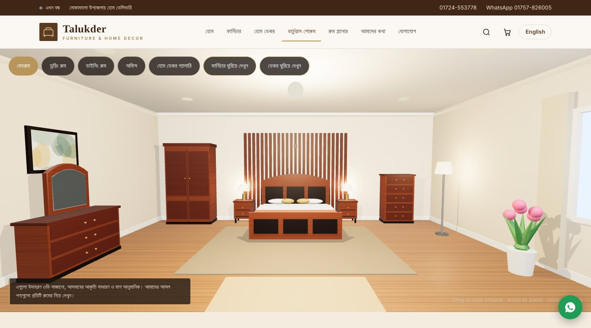
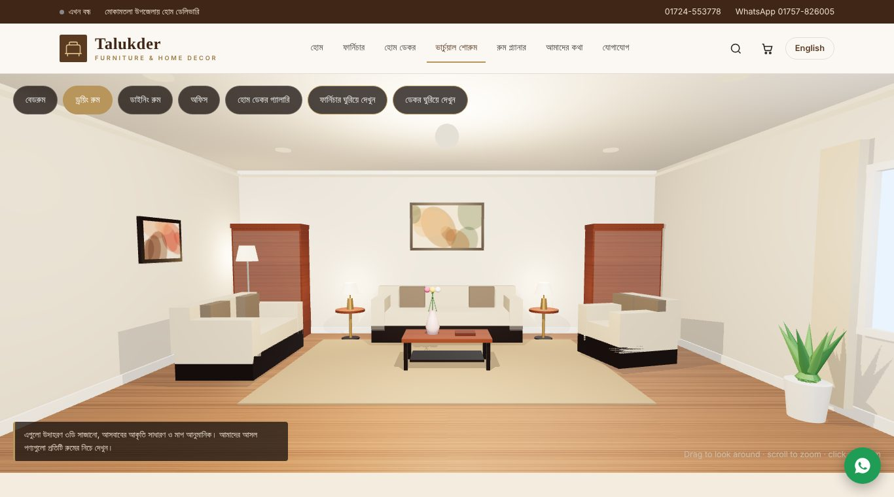
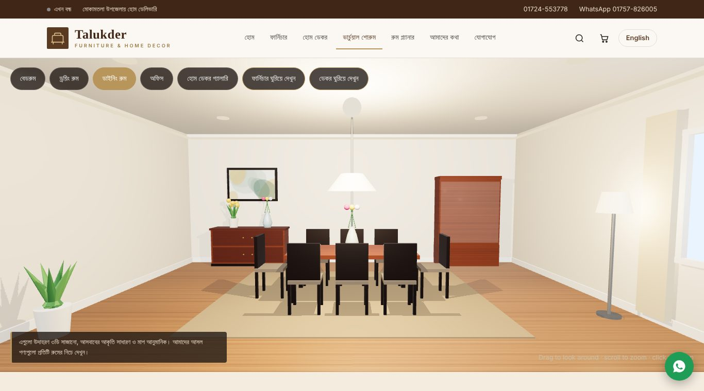
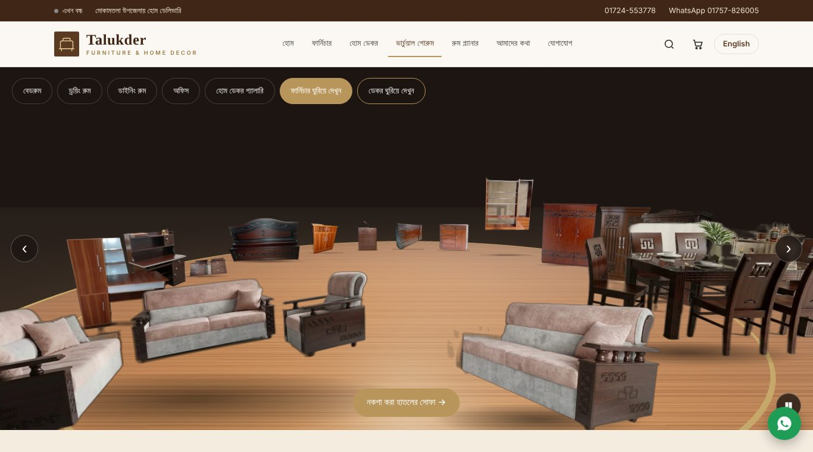
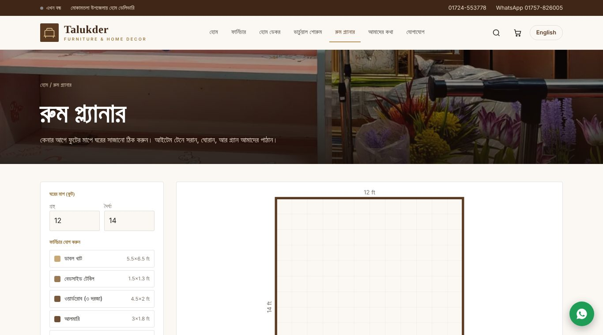

# Talukder Furniture & Home Decor

**Live website:** https://sifat049.github.io/talukder-furniture/

> **বাংলা:** মোকামতলা, বগুড়ার *Talukder Furniture & Home Decor* শোরুমের অফিশিয়াল ওয়েবসাইট। খাট, সোফা, ডাইনিং সেট, আলমারি, অফিস ফার্নিচার ও হোম ডেকর দেখুন, ৩ডি শোরুমে ঘুরে দেখুন, আর সরাসরি WhatsApp-এ অর্ডার করুন।
>
> **English:** Website for Talukder Furniture & Home Decor, a furniture shop in Mokamtola, Bogura, Bangladesh (owner: MD. Zillul Bary). Browse furniture and decor, walk through a 3D showroom, and order on WhatsApp.



## What you can do on the site

| Feature | What it does |
|---|---|
| **Furniture & Home Decor catalog** | Browse beds, sofas, dining sets, wardrobes, office furniture and decor, with search and filters |
| **3D Virtual Showroom** | Walk through Bedroom, Drawing Room, Dining, Office and Home Decor Gallery. Drag the mouse to look around. |
| **360° view** | See furniture and decor on a turning platform |
| **Room Planner** | Enter your room size in feet and drag furniture in to check the fit before buying |
| **Cart and WhatsApp order** | Add items to the cart and send the order list to the shop on WhatsApp |
| **Bangla / English** | One-click language switch. Bangla is the default. |

## Screenshots

### Furniture catalog


### 3D Virtual Showroom




### 360° view


### Room Planner


## Contact the shop

- Phone: 01724-553778
- WhatsApp: 01757-826005
- Address: Mokamtola, Bogura

## For developers

The site is static: plain HTML, CSS and JavaScript. There is no build step and no backend. Three.js is included in the repo.

**Run on your computer:**
```
git clone https://github.com/Sifat049/talukder-furniture.git
cd talukder-furniture
python3 -m http.server 8000
```
Then open http://localhost:8000.

**Add or change products:** product data is in `assets/js/data/catalog.js`. See `HOW-TO-ADD-PRODUCTS.txt` for the steps.

## Notes

- The showroom rooms are illustrative 3D layouts. Furniture shapes are generic and sizes are approximate. The real products are listed below each room.
- Items marked "AI design preview" are design previews, not photos of finished products.
